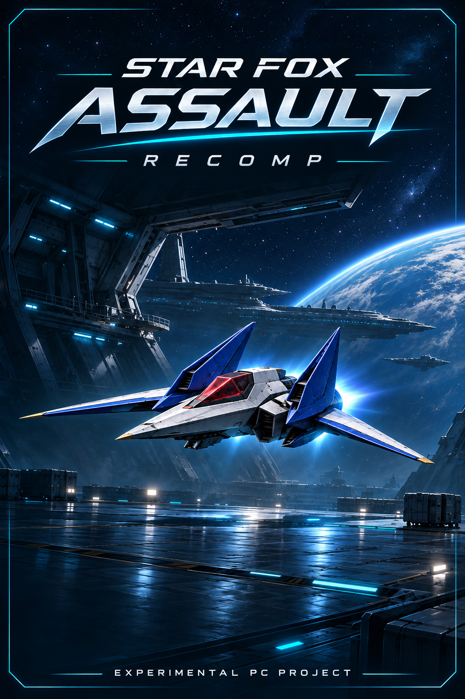
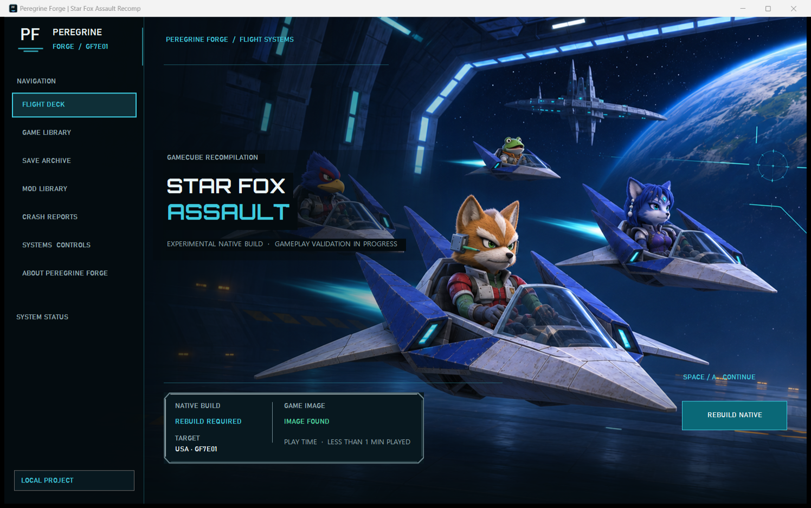

# Peregrine Forge — Star Fox Assault Recomp

**Launcher brand: Peregrine Forge.** The game title identifies this independent fan project; Peregrine Forge is the launcher name.

An experimental Windows x64 native recompilation project for the USA GameCube release **GF7E01**. The launcher imports your own ISO/CISO, recompiles its PowerPC code and builds a native Windows executable locally. The game image remains read-only. Windows 10 version 1903 or newer and an OpenGL 3.3-capable graphics driver are required.

<p align="center">
  
</p>

*Custom project cover based on the launcher's hangar artwork. This is fan-project artwork, not the original retail box cover.*

[Download the experimental Windows build](https://github.com/xSNAIRZx/star-fox-assault-recomp/releases/tag/v0.2.0-rc.3) · [Planned updates](ROADMAP.md) · [Validation and known issues](VALIDATION.md)

## Launcher preview



*The flight-deck artwork is an original AI-assisted fan-project illustration, not an in-game rendering. Game compatibility remains experimental.*

## Play from the shareable package

1. Extract the entire ZIP into a writable folder. Keep the launcher and its folders together.
2. Open **Star Fox Assault Recomp.exe**.
3. Select your own USA **GF7E01** `.iso` or `.ciso`, then choose **Import & Build**.
4. Wait for the build to finish, then choose **Play Native**.

The first build needs internet access, approximately 280 MB of portable build-tool downloads plus SDL source, and several GB of free disk space. Allow at least 3 GB free; additional space is useful for logs, backups and rebuilds. The launcher downloads pinned LLVM-MinGW, CMake, Ninja and Python releases, verifies their SHA-256 checksums, and keeps them inside `user-data/build-tools/`. It uses Windows PowerShell 5.1 and .NET Framework provided by Windows. No administrator installation, Visual Studio or Dolphin is required for the native build. Later builds reuse the local cache.

The distribution contains source, original launcher artwork, licensed display and replacement fonts, and a standalone image inspector. It excludes game images, extracted game executables, generated game code, precompiled game binaries, personal settings and saves. Each recipient supplies their own supported image and builds locally.

## Experimental status

The current source candidate is **0.2.0-rc.3**. Its package archive passed extraction, payload-hash, forbidden-content, asset-allowlist and PowerShell parser checks. The empty-cache **Import & Build** and bounded startup evidence below is from rc.2; those checks were not repeated for rc.3. This evidence verifies setup and limited startup only, not full-game compatibility.

First-mission flight, readable menus and saved-profile persistence have been tested. **The disappearing first boss and a current-thread-pointer crash remain unresolved.** Mission completion, later missions, complete audio fidelity and all physical controllers have not been verified. This release candidate is suitable for testing; it is not a stable full-game release.

The native runtime uses OpenGL. Graphics options include Match window or 1x–6x internal resolution, original 4:3, experimental 16:9, stretch, FXAA, Sharp/Smooth output filtering, fullscreen and VSync. Original 4:3 preserves the intended composition. Widescreen changes the 3D projection but still has game-specific culling limits. F8 switches Original/Wide during play; Alt+Enter toggles fullscreen. Higher resolution improves geometry edges without replacing original textures. Sharp with AA Off avoids FXAA softening.

The launcher also provides controller mapping, volume controls, session logs, save backups with pre-restore snapshots, local asset-pack import/rollback, local ZIP updates, credits and an optional separately installed Dolphin fallback. Native asset packs support one active pack and exact-size non-executable replacements. Online update and mod services are not implemented.

## Graphics and controls

Choose the internal resolution, 4:3 or experimental 16:9 aspect ratio, anti-aliasing, output filtering, volume, fullscreen, VSync and controller deadzone from Settings. Original 4:3 preserves the intended game composition; Sharp with AA Off keeps text crisp.

At the game's health-and-safety screen, focus the game window and press **Space** or **A** (or left-click) to continue. **Enter** sends Start; **B** or **Z** sends Back; **Escape** exits the game. Arrow keys steer, **I/J/K/L** navigate the D-pad, and **X/C/S/D/Q/W** provide the legacy action, face, Z and shoulder inputs. Mouse left/right/middle clicks send A/B/X. Press **F9** to capture the mouse and steer with relative movement; press F9 again or switch away from the game to release it. A connected controller works as well.

## Audio

The runtime mixes the game's DSP effects and streamed disc music into 48 kHz stereo. Streamed music now uses linear interpolation when its source rate differs from the output rate, intended to smooth 32-to-48 kHz playback. This source change still needs in-game listening validation; full soundtrack and cutscene fidelity remain unverified. The launcher currently offers master volume and a music mute option, with no separate music/effects balance or equalizer.

## Where the work is heading

The next steps are gameplay stability, picture quality, controls and audio, launcher polish and release readiness, in roughly that order. This is a proposed priority order, not a release schedule, and these items are planned work rather than completed fixes. See [the full roadmap](ROADMAP.md) for completion criteria, longer-term ideas and how to report a problem.

## Local files and updates

`portable.txt` keeps settings under `user-data/launcher-profile/`. Native saves, logs, build tools and build caches also stay under `user-data/`. Keep this folder when updating. A source-only update preserves the recipient's locally built game; use **Import & Build** to rebuild after changing source.

Cancelled or failed builds leave the previous native executable in place. A successful replacement retains `build-desktop/Release/assault.previous.exe`. The launcher does not convert or overwrite the ISO/CISO. Close the game before rebuilding or restoring a save backup.

## Build without the launcher

Run this from the extracted project folder, using the location of your own image:

```powershell
powershell.exe -NoProfile -ExecutionPolicy Bypass -File tools/Build-StarFoxAssault.ps1 -GameImage "C:\Games\Star Fox Assault.iso"
```

The same portable build worker powers **Import & Build**. `-Offline` reuses already downloaded tools and sources; it cannot perform the initial setup without cached downloads. Build output is placed in `build-desktop/Release/assault.exe`. Build tools and generated game code remain private local files under `user-data/`.

To rebuild only the small launcher executable, run `tools/Build-Launcher.ps1`; it uses the Windows .NET Framework compiler. Developers can also use the root CMake project with `GAME_ISO` set explicitly. Recompilation metadata is in `decomp/config/GF7E01/` and `recomp/`; builds do not depend on the ignored `analysis/` folder.

## Credits and validation

Project-authored software source and integration code are available under the top-level MIT `LICENSE`. Game content, artwork, fonts and third-party components retain their separate rights and terms; the software license does not grant rights in those materials.

The native runtime/recompiler derives from the MIT-licensed [gcn-recomp](https://github.com/ethannicholas/gcn-recomp). Analysis metadata uses the CC0 [decomp-toolkit template](https://github.com/encounter/dtk-template). See `CREDITS.md`, `THIRD_PARTY_NOTICES.md` and the component license files for attribution. This independent fan project is not affiliated with Nintendo, Namco or Foxhollow and contains no Foxhollow code or artwork.

`VALIDATION.md` records bounded tests and known limits. Startup checks and launcher screenshots do not establish full-game compatibility. `tools/Package-Prototype.ps1` produces a source-only ZIP by default, verifies its payload hashes and checks its scripts before delivery.
